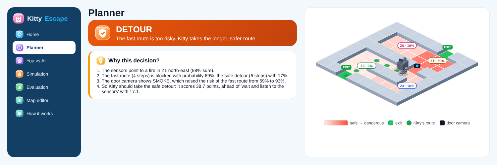
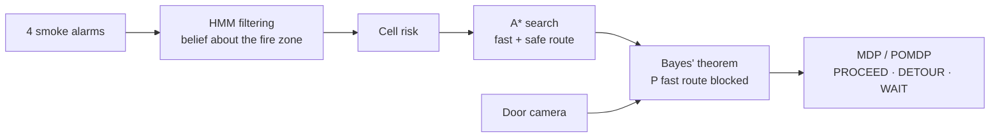
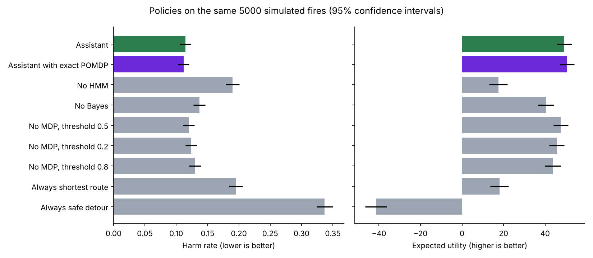
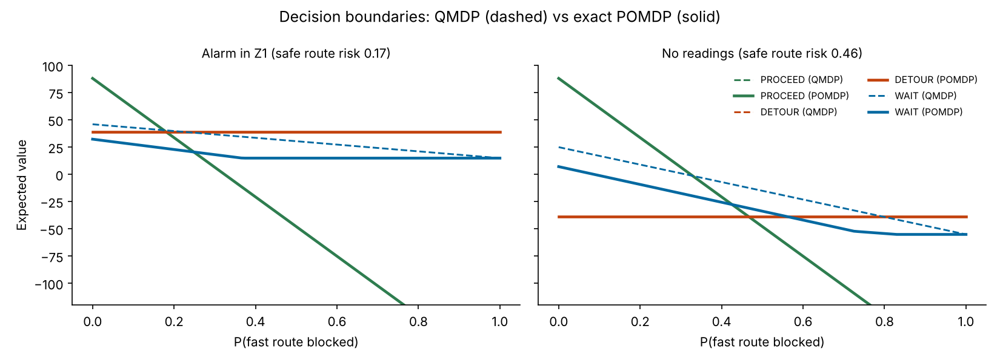
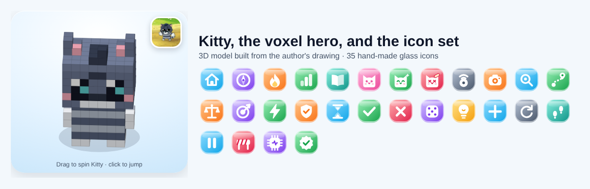

# Kitty Escape · Emergency Evacuation Assistant


AI Fundamentals final project (QAIRU). Individual project by **Yernur Baltabay**.

Kitty is trapped in a burning house. Four smoke alarms give noisy signals about a hidden, moving fire, and a camera
watches the door on the shortest way out. The assistant decides: **PROCEED** on the fast route, **DETOUR** on a safe
route, or **WAIT** for more information, and explains why in plain words.



## Four AI topics in one pipeline



| Topic | File | Role |
|---|---|---|
| Hidden Markov Model | `evacuation/hmm.py` | Filters the hidden fire zone from 4 noisy sensors (predict → update → normalize) |
| A* search | `evacuation/astar.py` | Cell cost = 1 + 10·P(blocked), admissible Manhattan heuristic |
| Bayes' theorem | `evacuation/bayes.py` | Updates P(fast route blocked) with the door camera reading |
| MDP + value iteration | `evacuation/mdp.py` | Expected value of every action under the Bayes belief (QMDP) |
| Integration | `evacuation/planner.py` | The full chain; exact route risk P(blocked) = Σ_z b(z)·(1 − Π_w (1 − B[z][w])) |

### Extensions that test and question the pipeline

| Extension | File | What it shows |
|---|---|---|
| Exact POMDP | `evacuation/pomdp.py` | Belief-space value iteration. QMDP assumes waiting reveals the truth, so it over-values WAIT; the POMDP prices the information correctly (+1.4 utility, paired CI excludes 0) |
| Baum-Welch (EM) | `evacuation/learn.py` | Learns the HMM from alarm logs alone: 0.697 / 0.904 / 0.288 / 0.069 vs the true 0.70 / 0.90 / 0.30 / 0.05 |
| Q-learning | `evacuation/qlearn.py` | Model-free agent reaches 46.6 utility after 30 000 fires; the MDP gets 49.3 with no training |
| Fair statistics | `evacuation/simulate.py` | Common random numbers, paired bootstrap 95% CIs, model-mismatch tests |
| Plain-language explanations | `evacuation/explain.py` | "Why this decision?" and a 5-step walkthrough built from the numbers of each run |

## Results (5000 simulated fires per policy, seed 2026, the same fires for every policy)

| Policy | Harm rate | Utility | Waited |
|---|---|---|---|
| **Assistant (HMM + A* + Bayes + MDP)** | **0.115 ± 0.005** | **49.3 ± 1.8** | 0.091 |
| Assistant with exact POMDP | 0.112 ± 0.004 | 50.6 ± 1.8 | 0.020 |
| No HMM (ignores smoke sensors) | 0.190 ± 0.006 | 17.5 ± 2.2 | 0.342 |
| No Bayes (ignores door camera) | 0.137 ± 0.005 | 40.4 ± 1.9 | 0.076 |
| No MDP, threshold 0.5 (hand-tuned) | 0.120 ± 0.005 | 47.6 ± 1.8 | 0 |
| No MDP, threshold 0.2 | 0.124 ± 0.005 | 45.6 ± 1.9 | 0 |
| No MDP, threshold 0.8 | 0.130 ± 0.005 | 43.7 ± 1.9 | 0 |
| Q-learning (30 000 training fires) | 0.121 ± 0.005 | 46.6 ± 1.9 | 0.107 |
| Always shortest route | 0.195 ± 0.006 | 18.0 ± 2.2 | 0 |
| Always safe detour | 0.337 ± 0.007 | −41.4 ± 2.7 | 0 |

Paired bootstrap (assistant minus other, utility): no HMM **+31.7** [28.2, 35.2], no Bayes **+8.9** [6.5, 11.5],
threshold 0.5 **+1.7** [−0.3, 3.6] (tie), threshold 0.2 **+3.7** [1.3, 6.1], threshold 0.8 **+5.6** [3.4, 7.8].

**Robustness.** When the real world is worse than the model (worse sensors, a faster fire and a worse camera together),
the assistant's harm rate rises from 0.109 to 0.149, still far below always taking the shortest route (0.191).




All tables: [`results/evaluation.md`](results/evaluation.md). Charts: `results/*.png`.

## Web interface

| Page | What you can do |
|---|---|
| Home | Spin the voxel 3D Kitty (built from the author's drawing), quick start |
| Planner | One-click scenarios, alarms and camera, *Why this decision?* with voice, risk map, decision boundary, MDP or exact POMDP, 5-step walkthrough |
| You vs AI | Ten fires: decide yourself, then compare with the AI on exactly the same fire |
| Simulation | A random fire with the real fire revealed |
| Evaluation | Policies, paired statistics, robustness, Baum-Welch, Q-learning |
| Map editor | Draw your own building; the Planner uses it |
| How it works | Every algorithm in technical and plain words |



## Run

```
python -m pip install -r requirements.txt
python main.py                  # console demo (input → calculation → output)
python -m pytest                # 28 tests
python evaluate.py              # full study → results/  (about 1-2 minutes)
python -m streamlit run app.py  # web interface
```
Public deployment: see [`DEPLOY.md`](DEPLOY.md).

## Assumptions
All probabilities and rewards are assumptions in `evacuation/model.py` (`Config`), not measured data. Baum-Welch shows
how they could be fitted to real sensor logs.

## Limitations
- The parameters have not been fitted to real data; Baum-Welch was tested on simulated logs.
- The robustness test changes parameters but keeps the model's structure (four zones, one fire).
- The decision state is two-valued (fast route clear or blocked); zones are the four quarters of the 8 × 8 grid, also on user-drawn maps.
- One person, no crowd flow; a teaching model, not a certified safety system.

## Version history
Each version is a commit with a git tag (`v1` … `v6`).

| Version | Content |
|---|---|
| v1 | Core pipeline: HMM, A*, Bayes, MDP, console demo, first web page, tests |
| v2 | Monte Carlo evaluation, baselines, ablation, sensitivity, report, slides, CI |
| v3 | New interface (sidebar navigation, quiz-style decision cards) |
| v4 | Gamification: Kitty, isometric map with animated route |
| v5 | Custom glass icon set, voxel 3D Kitty, 13 UX improvements |
| v6 | POMDP, Baum-Welch, Q-learning, robustness and paired statistics, You vs AI, map editor, decision boundary, voice |

Versions v1–v4 were written on 23 November 2026 and v5–v6 on 25 November 2026; the whole history was uploaded to
GitHub on 25 November 2026.

## Documents
`docs/Technical_Report.docx`, `docs/Presentation.pptx`, `docs/Video_Script.md`, `docs/Defense_QA.md`,
`AI_USAGE_DECLARATION.md`, `TEAM_CONTRIBUTION.md`
